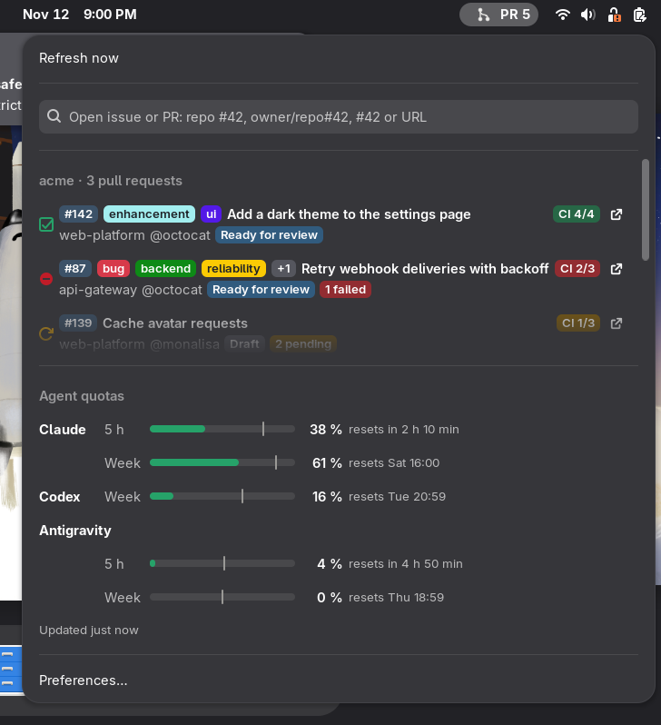
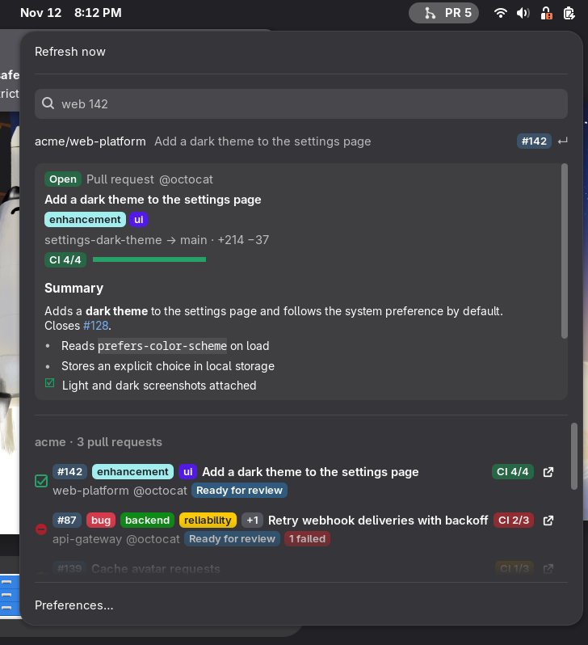
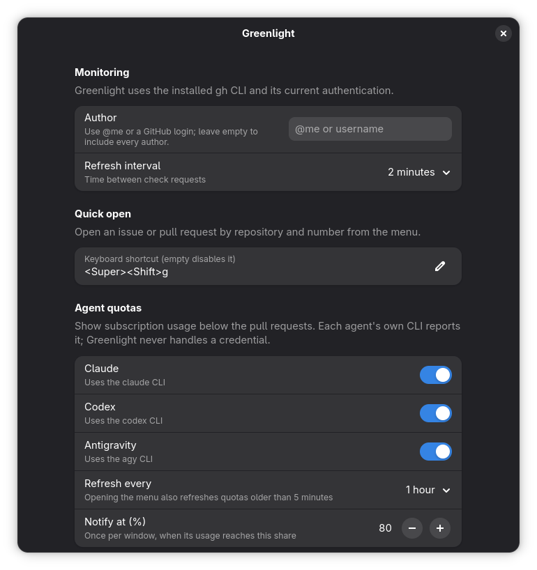

# Greenlight

**Your PRs and your agents' quotas, in the GNOME top bar.**

Claude Code, Codex, and Gemini now open your pull requests across a dozen repositories. Two
questions come back all day: *which ones are green?* and *am I burning my quota too fast?*
Greenlight answers both from one click in the top bar. You don't need a browser tab or a
dashboard, and it stores no token.

  
  

- **Every open PR, at a glance.** Your PRs across accounts and organizations, grouped by owner,
  with labels, review state, and CI results.
- **The green light.** A desktop notification when a PR's checks turn green. Merge it, or hand it
  back to the agent, as soon as it is ready.
- **Agent quota gauges.** Your Claude, Codex, and Antigravity (Gemini) 5-hour and weekly
  windows, each with a pace mark that shows whether you spend faster than the window allows,
  and an alert at your threshold.
- **Quick open.** <kbd>Super</kbd>+<kbd>Shift</kbd>+<kbd>G</kbd>, type `api 42`, check the
  preview, and press Enter.
- **No credentials.** Greenlight reuses `gh` and each agent's own CLI. It never reads, stores,
  or sends a token.

## Requirements

- GNOME Shell 49 or 50
- GitHub CLI (gh), authenticated for the account and host you want to monitor
- Optional, for agent quotas: Claude Code on a Claude subscription, the Codex CLI signed in with ChatGPT, and/or the Antigravity CLI (`agy`) signed in with Google

Check the GitHub CLI session with:

~~~sh
gh auth status
~~~

## Install

Download the zip of the [latest release](https://github.com/cr0cK/greenlight/releases/latest) and
install it:

~~~sh
curl -fsSLo /tmp/greenlight.zip https://github.com/cr0cK/greenlight/releases/latest/download/greenlight@cr0ck.github.io.shell-extension.zip
gnome-extensions install --force /tmp/greenlight.zip
~~~

The same commands update an existing install. For a specific version, replace `latest/download`
with `download/vX.Y.Z`.

To install from a checkout instead, run `make install` from the repository root.

GNOME Shell must reload its extension list before you enable a newly installed extension. On Wayland, log out and back in. On X11, press Alt+F2, enter r, and press Enter.

Then enable Greenlight:

~~~sh
gnome-extensions enable greenlight@cr0ck.github.io
~~~

## Use

### Set up

Open **Preferences** from the menu:

1. **Discover accounts** loads your account and organizations from `gh`. To add another owner,
   enter its login.
2. In each owner's block, choose **All**, **All except…**, or **Only…** repositories.
3. Under **Agent quotas**, turn on the agents you use. Each switch checks its CLI first. If the
   CLI is missing, signed out, or not on a subscription, the switch stays off and says what to do.
4. Click **Save preferences**.

Until you configure owners, Greenlight watches every repository `gh` can see.

  

### Pull requests

- The indicator counts the pull requests Greenlight monitors, up to the 30 most recently updated.
- Each row shows the number, labels, title, and CI badge (passed out of total checks), then the
  repository, author, Draft or Ready for review, and the failed or pending checks.
- To preview a pull request, click its row, or press <kbd>Space</kbd>. Click the row again to
  close the preview. To open it in your browser, double-click the row, click its icon, or press
  <kbd>Enter</kbd>.
- A pull request is green when every check passed. Skipped checks count as passed once at least
  one check passed. A pull request with no checks is never green.
- Greenlight refreshes every 2 minutes (you can set 30 s to 10 min). The first refresh, and each
  filter change, only records the current state: pull requests that are already green do not
  notify.

### Quick open

<kbd>Super</kbd>+<kbd>Shift</kbd>+<kbd>G</kbd> opens the menu with the quick open field
focused (you can change the shortcut in Preferences). Type `plat 42`, `plat#42`, `#42`,
`owner/repo#42`, or paste a GitHub URL. The preview shows the state, the author, a CI bar with
the names of the failed checks, and the description rendered as Markdown.

### Agent quotas

Each provider shows one line per window (`5 h`, `Week`):

- **The bar** is the share used. It turns yellow at your threshold (80 % by default) and red
  at 100 %.
- **The pace mark** is the share of the window that has elapsed. A bar that passes the mark
  means you spend faster than the quota allows.
- **The reset time** is when the window starts over.

Each window notifies you once per period when it reaches the threshold. Quotas refresh every
hour (you can set 15 min to 4 h), on **Refresh now**, and when you open the menu more than
5 minutes after the last refresh. If a refresh fails, the last reading stays, dimmed, with the
cause.

Greenlight asks the agents' own CLIs, which it looks for in `PATH` and then in `~/.local/bin`:

- `claude -p /usage` uses no tokens and saves no session.
- `codex app-server` reads the Codex rate limits.
- `agy -p /usage` reads the Gemini models only. A signed-out `agy` never opens a browser.

### When something goes wrong

A failed refresh adds a row under **Refresh now** that says why: `gh` is missing from `PATH`,
`gh` is not signed in (run `gh auth login`), GitHub is unreachable, or you reached the rate
limit. The last pull requests stay listed, and a dimmed line quotes gh's own message. The shell
log keeps it too: `journalctl --user -b | grep Greenlight`.

How the search works

Each refresh first checks, in one `gh api graphql` request, that the enabled owners and selected
repositories still exist. It skips the ones that do not, lists them under **Refresh now**, and
searches the rest. Greenlight searches each owner and repository scope with `gh search prs`,
excludes archived repositories, merges the results, and reads the checks of the 30 most recently
updated pull requests one after another. Owner and repository qualifiers go in separate
commands. An owner with exclusions gets its own command with `-repo:` terms. Exclusions that do
not fit in the query are filtered from the results instead, and the search fetches more results
until the owner's share is complete, so the counts stay exact.

**All except…** keeps new repositories monitored; **Only…** monitors just the repositories you
turn on. A switch that is on always means monitored, so switching between the two modes keeps
your choice and changes only what happens to new repositories.

Quick open suggests the repositories selected in Preferences, the repositories of the pull
requests in the menu, and the repositories you opened recently. `#42` alone lists only the
watched repositories where #42 exists. A preview costs one `gh api graphql` request, cached for
a minute.

To remove Greenlight:

~~~sh
gnome-extensions uninstall greenlight@cr0ck.github.io
~~~

## Contributing

Bug reports, ideas, and pull requests are welcome. [CONTRIBUTING.md](CONTRIBUTING.md) covers the
development setup, the checks, and the sandbox that runs the extension in a windowed GNOME Shell.
Report vulnerabilities privately as described in [SECURITY.md](.github/SECURITY.md).

See [docs/specs/](docs/specs/) for the specs, and
[CHANGELOG.md](CHANGELOG.md) for release notes.

## License

[MIT](LICENSE)
