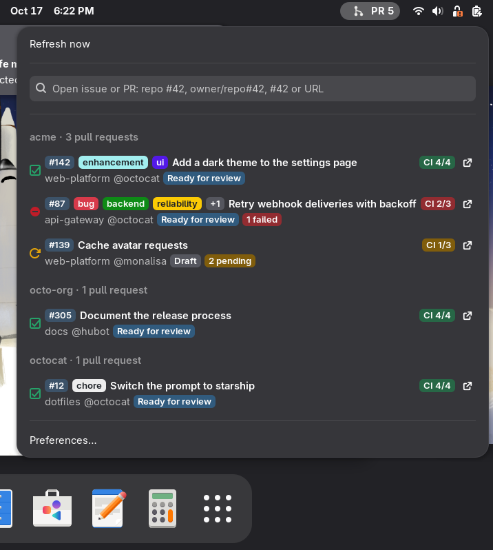
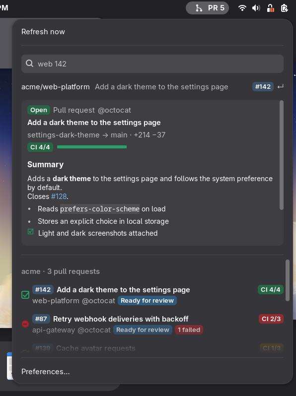
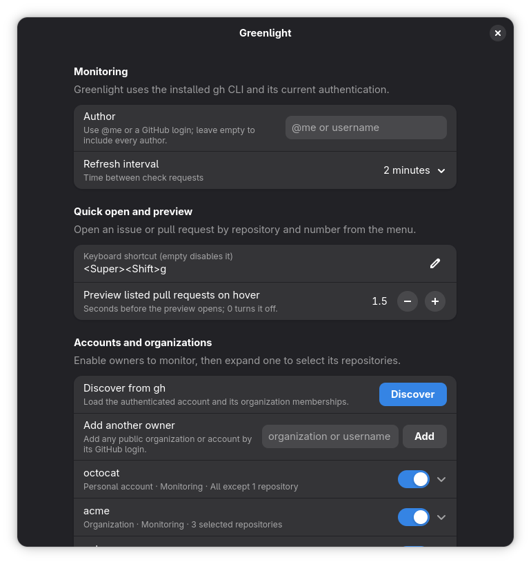

# Greenlight

A small GNOME Shell extension that watches your open GitHub pull requests and gives you the green light when their checks pass. It uses your existing local GitHub CLI authentication and stores no GitHub token.

  
  

## Features

- Shows your open pull requests in the GNOME top bar menu.
- Shows each pull request's labels, author, draft/review status, CI pass count, and failure count.
- Filters pull requests across multiple accounts and organizations: all of an owner's repositories, all except a few, or only a selection.
- Groups pull requests by owner and sorts each group by last update, newest first.
- Opens a pull request in your browser when selected.
- Opens any issue or pull request of a watched repository from its number, with a configurable keyboard shortcut and an inline preview of its description and CI.
- Sends a desktop notification when a pull request reaches a new green check run.
- Lets you set the polling interval from 30 seconds to 10 minutes.

The initial refresh establishes a baseline, so pull requests that are already green do not trigger startup notifications. Changing the repository or author filter also establishes a quiet baseline. The search is capped at the 30 most recently updated open pull requests.

## Requirements

- GNOME Shell 49
- GitHub CLI (gh), authenticated for the account and host you want to monitor

Check the GitHub CLI session with:

~~~sh
gh auth status
~~~

## Install

Download the zip of the [latest release](https://github.com/cr0cK/greenlight/releases/latest) and
install it:

~~~sh
curl -fsSLo /tmp/greenlight.zip https://github.com/cr0cK/greenlight/releases/latest/download/greenlight@cr0ck.github.io.shell-extension.zip
gnome-extensions install --force /tmp/greenlight.zip
~~~

The same commands update an existing install. For a specific version, replace `latest/download`
with `download/vX.Y.Z`.

To install from a checkout instead, run `make install` from the repository root.

GNOME Shell must reload its extension list before you enable a newly installed extension. On Wayland, log out and back in. On X11, press Alt+F2, enter r, and press Enter.

Then enable Greenlight:

~~~sh
gnome-extensions enable greenlight@cr0ck.github.io
~~~

## Use

The panel indicator shows how many pull requests Greenlight is monitoring, up to 30. Open its menu to review their statuses and click one to open it in your browser. Pull requests are sorted by most recently updated.

  

In Preferences, use **Discover** to load the account and organizations available to the active `gh` authentication. You can also add any public organization or account by its login. Expand an owner and pick **All**, **All except…**, or **Only…** under **Repositories**. **All except…** keeps new repositories monitored and lists the loaded repositories to turn off the ones to skip; **Only…** monitors just the repositories turned on. A switch on always means monitored, so changing between the two keeps the current choice and only changes what happens to new repositories. Each owner keeps its own repository selection. The **Save preferences** button applies owners, repositories, author, and refresh interval together. The **About** group at the bottom shows the installed version and links to this repository. Before owner filters are configured, the extension searches all repositories visible to `gh`; after configuration, only enabled owners and their selected repositories are included.

The menu groups pull requests under their account or organization. Each row puts the number, labels, title, and CI badge on the first line, then the repository, author, review state, and any failure or pending counts on the second. The panel icon remains a neutral pull request symbol.

Use the quick open field under **Refresh now** to open an issue or pull request by number. Type part of a repository name and the number, such as `plat 42` or `plat#42`, then press Enter. `#42` alone lists only the watched repositories where #42 exists, with its title, `owner/repo#42` works for any repository, and a pasted GitHub URL opens as is. Suggestions come from repositories selected in Preferences, repositories of the pull requests in the menu, and recently opened repositories. Once a number is typed, a panel previews the highlighted suggestion: state, author, labels, branches, a CI bar with failed check names, and the description rendered as GitHub-flavored Markdown. The preview scrolls; click it to open the issue or pull request, or click a link inside it to open that link. It uses one `gh api graphql` request, cached for a minute. Super+Shift+G opens the menu with the field focused; change or clear the shortcut in Preferences. Resting on a listed pull request for 1.5 seconds opens the same preview under it; Preferences sets the delay, and 0 turns it off.

Each pull request row shows its labels in their GitHub colors, its author, Draft or Ready for review status, passed checks out of total checks, and the number of failures, pending checks, skipped checks, and cancellations.

Greenlight searches the selected owner or repository scopes through `gh search prs` and excludes archived repositories. It merges and sorts the results, then reads checks for the 30 most recently updated pull requests sequentially. Owner and repository search qualifiers are kept in separate commands. An owner with exclusions gets its own command with `-repo:` terms; exclusions that do not fit in the query are filtered from the results instead, and the search fetches more results until the owner's share is complete, so counts stay exact. A refresh normally runs every two minutes; the interval can be set to 30, 60, 120, 300, or 600 seconds.

Skipped checks are treated as non-blocking when at least one check has passed. A pull request with no checks is not considered green.

To remove Greenlight:

~~~sh
gnome-extensions uninstall greenlight@cr0ck.github.io
~~~

## Contributing

Bug reports, ideas, and pull requests are welcome. [CONTRIBUTING.md](CONTRIBUTING.md) covers the
development setup, the checks, and the sandbox that runs the extension in a windowed GNOME Shell.
Report vulnerabilities privately as described in [SECURITY.md](.github/SECURITY.md).

See [docs/specs/](docs/specs/) for the product contracts, and
[CHANGELOG.md](CHANGELOG.md) for release notes.

## License

[MIT](LICENSE)
