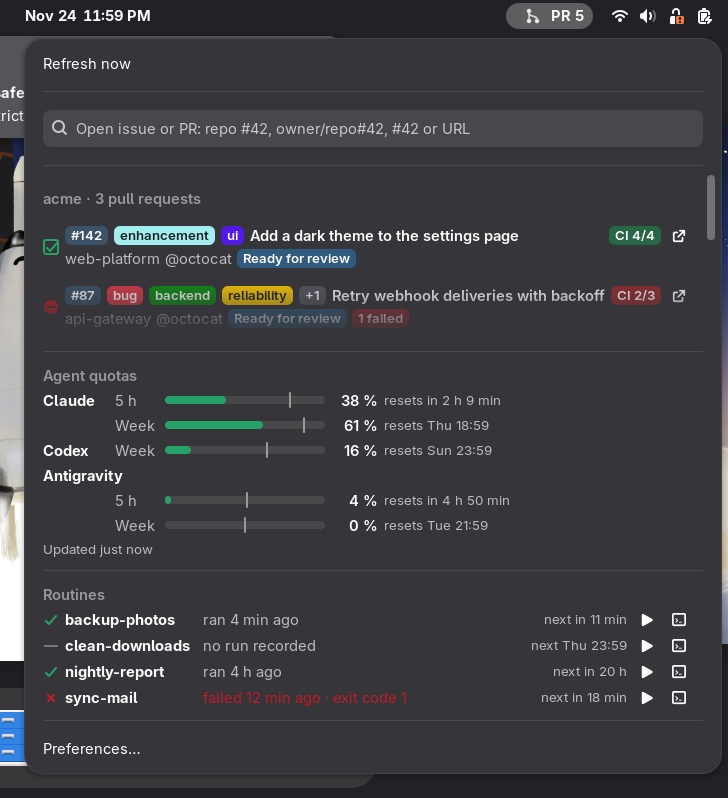
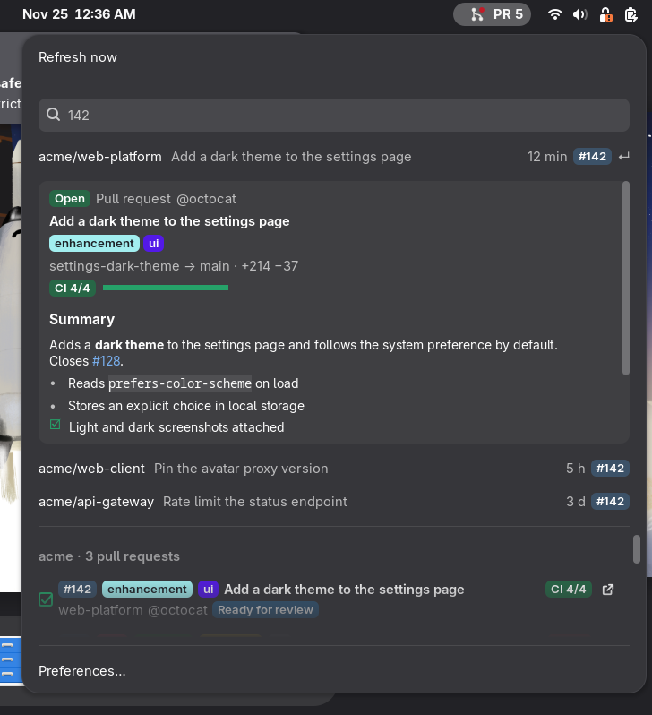
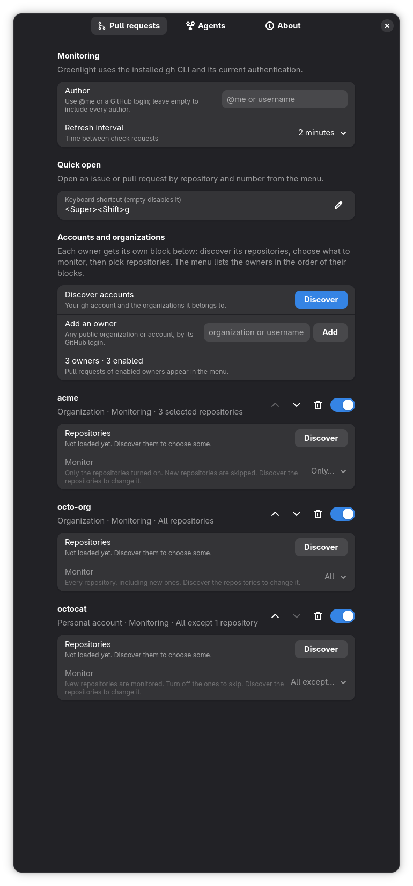
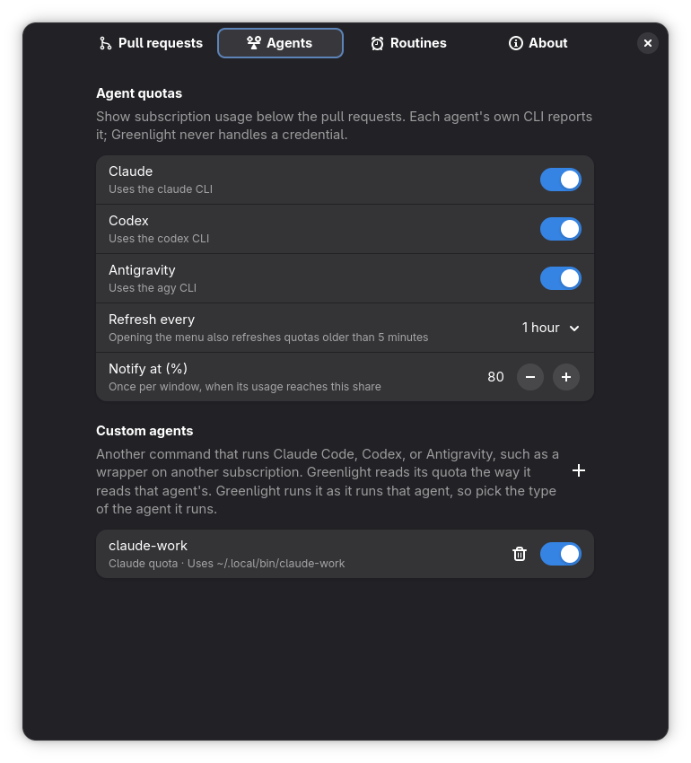
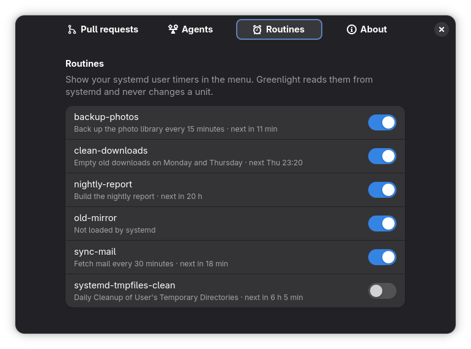
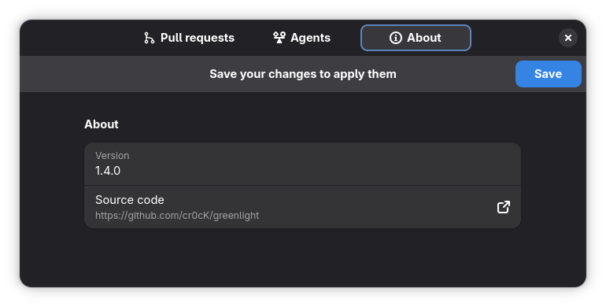

# Greenlight

**Your PRs and your agents' quotas, in the GNOME top bar.**

Claude Code, Codex, and Gemini now open your pull requests across a dozen repositories. Two
questions come back all day: *which ones are green?* and *am I burning my quota too fast?*
Greenlight answers both from one click in the top bar. You don't need a browser tab or a
dashboard, and it stores no token.

  
  

- **Every open PR, at a glance.** Your PRs across accounts and organizations, grouped by owner,
  with labels, review state, and CI results.
- **The green light.** A desktop notification when a PR's checks turn green. Merge it, or hand it
  back to the agent, as soon as it is ready.
- **Agent quota gauges.** Your Claude, Codex, and Antigravity (Gemini) 5-hour and weekly
  windows, each with a pace mark that shows whether you spend faster than the window allows,
  and an alert at your threshold. Add your own agent commands, such as a wrapper on another
  subscription, to read their quota too.
- **Routines.** The systemd user timers you pick, in the menu: how each one's last run ended
  and when it runs next, with **Run now** and **View logs** buttons. A failed run sends a
  notification and puts a red dot on the panel icon.
- **Quick open.** <kbd>Super</kbd>+<kbd>Shift</kbd>+<kbd>G</kbd>, type `api 42`, check the
  preview, and press Enter.
- **No credentials.** Greenlight reuses `gh` and each agent's own CLI. It never reads, stores,
  or sends a token.

## Requirements

- GNOME Shell 49 or 50
- GitHub CLI (gh), authenticated for the account and host you want to monitor
- Optional, for routines: systemd user timers (`systemctl --user list-timers`)
- Optional, for agent quotas: Claude Code on a Claude subscription, the Codex CLI signed in with ChatGPT, and/or the Antigravity CLI (`agy`) signed in with Google

Check the GitHub CLI session with:

~~~sh
gh auth status
~~~

## Install

Download the zip of the [latest release](https://github.com/cr0cK/greenlight/releases/latest) and
install it:

~~~sh
curl -fsSLo /tmp/greenlight.zip https://github.com/cr0cK/greenlight/releases/latest/download/greenlight@cr0ck.github.io.shell-extension.zip
gnome-extensions install --force /tmp/greenlight.zip
~~~

The same commands update an existing install. For a specific version, replace `latest/download`
with `download/vX.Y.Z`.

To install from a checkout instead, run `make install` from the repository root.

GNOME Shell must reload its extension list before you enable a newly installed extension. On Wayland, log out and back in. On X11, press Alt+F2, enter r, and press Enter.

Then enable Greenlight:

~~~sh
gnome-extensions enable greenlight@cr0ck.github.io
~~~

## Use

### Set up

Open **Preferences** from the menu. It has four tabs, **Pull requests**, **Agents**, **Routines**, and **About**:

1. On **Pull requests**, **Discover accounts** loads your account and organizations from `gh`. To
   add another owner, enter its login.
2. In each owner's block, choose **All**, **All except…**, or **Only…** repositories.
3. Move each owner's block with its up and down buttons: the menu lists the owners in that order.
4. On **Agents**, turn on the agents you use. Each switch checks its CLI first. If the CLI is
   missing, signed out, or not on a subscription, the switch stays off and says what to do. To
   read another command's quota, such as a wrapper that runs Claude Code on another
   subscription, add it under **Custom agents** with **+**: type its name or path, pick the
   quota type of the agent it runs, and press Enter.
5. On **Routines**, turn on the systemd user timers you want in the menu. Nothing is watched by
   default.
6. Once something changed, a banner at the top of every tab names the tabs with unsaved changes.
   Click **Save** in it, or press <kbd>Ctrl</kbd>+<kbd>S</kbd>. One save applies every tab, and the
   window stays open. Closing the window drops what was not saved.

Until you configure owners, Greenlight watches every repository `gh` can see.

  

  
  
  

### Pull requests

- The indicator counts the pull requests Greenlight monitors, up to the 30 most recently updated.
- Each row shows the number, labels, title, and CI badge (passed out of total checks), then the
  repository, author, Draft or Ready for review, and the failed or pending checks.
- To preview a pull request, click its row, or press <kbd>Space</kbd>. Click the row again to
  close the preview. To open it in your browser, double-click the row, click its icon, or press
  <kbd>Enter</kbd>.
- A pull request is green when every check passed. Skipped checks count as passed once at least
  one check passed. A pull request with no checks is never green.
- Owners are listed under their own heading, in the order of their blocks in the preferences. Owners
  you have not placed yet follow, your accounts first, then your organizations, each by login.
  Pull requests without an owner come last. Saving a new order re-sorts the list without calling
  GitHub.
- Greenlight refreshes every 2 minutes (you can set 30 s to 10 min). The first refresh, and each
  filter change, only records the current state: pull requests that are already green do not
  notify.

### Quick open

<kbd>Super</kbd>+<kbd>Shift</kbd>+<kbd>G</kbd> opens the menu with the quick open field
focused (you can change the shortcut in Preferences). Type `plat 42`, `plat#42`, `#42`,
`owner/repo#42`, or paste a GitHub URL. The preview shows the state, the author, a CI bar with
the names of the failed checks, and the description rendered as Markdown.

When a number exists in several repositories, they are listed newest activity first, each with
its age (`12 min`, `5 h`, `3 d`, then the date), so the one updated last comes first.
A repository you typed in full (`acme/web#42`, `web 42`) stays first. If the lookup fails, the
repositories are listed by name match, without ages.

### Agent quotas

Each provider shows one line per window (`5 h`, `Week`):

- **The bar** is the share used. It turns yellow at your threshold (80 % by default) and red
  at 100 %.
- **The pace mark** is the share of the window that has elapsed. A bar that passes the mark
  means you spend faster than the quota allows.
- **The reset time** is when the window starts over.

Each window notifies you once per period when it reaches the threshold. Quotas refresh every
hour (you can set 15 min to 4 h), on **Refresh now**, and when you open the menu more than
5 minutes after the last refresh. If a refresh fails, the last reading stays, dimmed, with the
cause.

Greenlight asks the agents' own CLIs, which it looks for in `PATH` and then in `~/.local/bin`:

- `claude -p /usage` uses no tokens and saves no session.
- `codex app-server` reads the Codex rate limits.
- `agy -p /usage` reads the Gemini models only. A signed-out `agy` never opens a browser.

### Custom agents

A custom agent is a command that runs Claude Code, Codex, or Antigravity under another name, such
as a wrapper that keeps its own sign-in on another subscription. Under **Preferences** >
**Agents** > **Custom agents**, click **+**, type a command name (found in `PATH`, then in
`~/.local/bin`) or a path (`/…` or `~/…`) to an executable file, and pick the **Quota type** of the
agent it runs. Greenlight then reads its quota exactly as it reads that agent's, with the same
arguments, shows it after the built-in agents under the command's name, and notifies at your
threshold as `claude-work weekly quota at 84 %`.

- Up to 5 custom agents, in the order you added them. Each has its own switch and a trash button.
- The command receives the arguments of its type (`-p /usage …` for Claude and Antigravity,
  `app-server` for Codex), so pick the type of the agent it runs. A wrapper should end by running
  its agent with `exec` and the arguments it received.
- Enter checks the command before adding it: a command or name already listed, a built-in agent's
  name, a missing file, or a link to the built-in CLI of the same type is refused with its reason.
- Greenlight passes the command no argument or variable of its own: a wrapper that needs some is
  a script.

### Routines

The **Routines** section lists the timers you turned on, by name, below the agent quotas. Each
row shows:

- **The last run**: a green check and `ran 4 min ago`, a red cross and `failed 12 min ago · exit
  code 1`, a yellow dot and `running since 12:02`, or a grey dash for a run skipped by a
  condition (`skipped`), a timer that never ran (`no run recorded`), a result Greenlight cannot
  read (`result unknown`), or a service systemd does not load (`service not loaded`).
- **The next run**: `next in 11 min`, `next Thu 13:00`, or `not scheduled`.
- **Two buttons**: **Run now** (the play icon) asks systemd to start the routine's service once,
  and **View logs** (the terminal icon) opens a terminal on `journalctl --user -u <service> -e`.

**Run now** keeps the menu open and is greyed out while the routine runs. A start that does not
happen says why in a dimmed line under the row (`Could not start nightly-report: job dependency`)
until the next successful start or the menu closes. **View logs** closes the menu and opens the
first terminal it finds, among `xdg-terminal-exec`, `ptyxis`, `kgx`, and `gnome-terminal`, in
`PATH` or `~/.local/bin`; without one, a line under the row gives the `journalctl` command to run
yourself. When that terminal command exits with a failure or a signal within 5 seconds, a
notification names the status and the command to run. Both buttons take the keyboard focus in order with <kbd>Tab</kbd>, and act on
<kbd>Enter</kbd> or <kbd>Space</kbd>.

With more than six routines the rows scroll. The section hides while quick open has text.

**Failures.** Each failed run you watch sends one notification, `nightly-report failed`, with the
cause and the time of the run (`exit code 1 · 03:12`); clicking it opens the logs as **View logs**
does, or says why they did not open. A red dot sits on the top right corner of the panel icon,
and its accessible name reads `Greenlight, a routine failed`, while a watched routine is failed;
it goes away with the failure (the next run, `systemctl --user reset-failed`, or the routine no
longer watched), never by opening the menu. Greenlight notifies the failures it sees: a routine
that is already failed when Greenlight starts or when you start watching it shows the dot but
does not notify, and a run that fails and is followed by another before Greenlight reads (within a
second, or 30 seconds without systemd's signals) is not seen.

Greenlight reads systemd's own D-Bus API and never creates, edits, enables, disables, or stops a
unit; its only write is **Run now**. It listens to systemd only
while a routine is watched, and updates a row within a second of a change. A row dims when systemd
cannot be read, and the section says why. systemd keeps its history in memory: after your systemd
restarts (a new login without lingering), a routine reads `no run recorded` until it runs.

### When something goes wrong

A failed refresh adds a row under **Refresh now** that says why: `gh` is missing from `PATH`,
`gh` is not signed in (run `gh auth login`), GitHub is unreachable, or you reached the rate
limit. The last pull requests stay listed, and a dimmed line quotes gh's own message. The shell
log keeps it too: `journalctl --user -b | grep Greenlight`.

How the search works

Each refresh first checks, in one `gh api graphql` request, that the enabled owners and selected
repositories still exist. It skips the ones that do not, lists them under **Refresh now**, and
searches the rest. Greenlight searches each owner and repository scope with `gh search prs`,
excludes archived repositories, merges the results, and reads the checks of the 30 most recently
updated pull requests one after another. Owner and repository qualifiers go in separate
commands. An owner with exclusions gets its own command with `-repo:` terms. Exclusions that do
not fit in the query are filtered from the results instead, and the search fetches more results
until the owner's share is complete, so the counts stay exact.

**All except…** keeps new repositories monitored; **Only…** monitors just the repositories you
turn on. A switch that is on always means monitored, so switching between the two modes keeps
your choice and changes only what happens to new repositories.

Quick open suggests the repositories selected in Preferences, the repositories of the pull
requests in the menu, and the repositories you opened recently. `#42` alone lists only the
watched repositories where #42 exists. A preview costs one `gh api graphql` request, cached for
a minute.

To remove Greenlight:

~~~sh
gnome-extensions uninstall greenlight@cr0ck.github.io
~~~

## Contributing

Bug reports, ideas, and pull requests are welcome. [CONTRIBUTING.md](CONTRIBUTING.md) covers the
development setup, the checks, and the sandbox that runs the extension in a windowed GNOME Shell.
Report vulnerabilities privately as described in [SECURITY.md](.github/SECURITY.md).

See [docs/specs/](docs/specs/) for the specs, and
[CHANGELOG.md](CHANGELOG.md) for release notes.

## License

[MIT](LICENSE)
